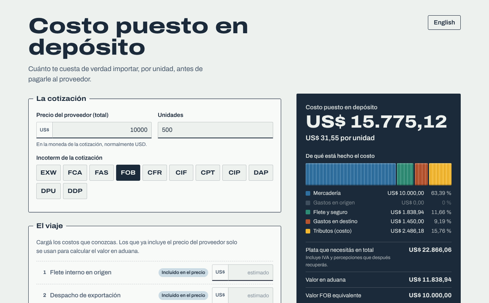

# Landed cost · Costo puesto en depósito

**What an import really costs you, per unit, before you pay the supplier.**

A free calculator for small importers, freight forwarders' clients and foreign-trade students. Enter the supplier's quote under any **Incoterm 2020**, the costs you know along the way, and the tax regime; get the customs value, every duty and tax, the cash you need on the day of clearance, the final landed cost per unit and a suggested selling price.



**Live:** published with GitHub Pages from this repository (see `Settings → Pages`).

## Why another calculator

Most import calculators online either sell you a service, need a sign-up, or quietly get two things wrong:

1. **They ignore the Incoterm.** A CIF quote already includes freight and insurance; an EXW quote doesn't even include export clearance. This tool marks each step of the journey as *included in the price* or *you pay*, and derives the FOB and customs value from any term. The same shipment quoted EXW, FOB or CIF gives the same landed cost, and that is a unit test.
2. **They treat recoverable taxes as cost.** In Argentina, VAT and the VAT, income-tax and gross-income prepayments (*percepciones*) are a big cash outlay at customs, but a registered business credits them later. The calculator separates **cash you need** from **cost that stays**, and lets consumers and small businesses switch that off.

## Features

- **Customs value from any Incoterm.** It handles EXW, FCA, FAS, FOB, CFR, CIF, CPT, CIP, DAP, DPU and DDP, on a CIF or FOB valuation basis.
- **Argentine general-regime preset.** It includes import duty, the 3% statistics fee with its per-tier USD caps, VAT, additional VAT, income-tax and gross-income prepayments. VAT and the prepayments are computed on customs value + duty + fees, as customs does.
- **Generic presets** (duty + VAT; FOB basis) and fully editable rates.
- **Insurance estimate** as a premium over 110% of FOB + freight, the usual cargo-insurance convention.
- **Per-unit cost, import multiplier, local currency and suggested price** from a target margin.
- **"Who pays what" explorer.** It shows the route from factory to warehouse for each Incoterm, marking where risk passes and where the seller's costs end. This makes the C-terms' "two critical points" visible at a glance.
- **Spanish and English.** The language is detected from the browser and can be switched at any time.
- **Shareable links.** The whole scenario lives in the URL, so you can send a quote comparison to a colleague or a customs broker.
- **CSV export** opens correctly in Excel with Spanish locale (`;` separator, decimal comma). There is also a print layout.
- **Private.** It is static, has no backend and no analytics, and the font is self-hosted. Nothing you type leaves your browser.
- **Accessible and responsive.** It has keyboard focus styles, labelled controls, a live region for results, reduced-motion support, dark mode and a phone layout.

## How the numbers are computed

```
FOB value      = quote price
                 + origin costs the buyer pays (EXW/FCA/FAS)
                 − post-FOB costs already in the price (C and D terms)
Customs value  = FOB + freight + insurance      (CIF basis)
               = FOB                            (FOB basis)
Duty, fees     = customs value × rate           (statistics fee capped by tier)
VAT & prepay.  = (customs value + duty + fees) × rate
Landed cost    = price + costs you pay + taxes that are not recoverable
Cash needed    = price + costs you pay + all taxes
```

Everything lives in [`js/calc.js`](js/calc.js), a dependency-free module with no DOM access, covered by tests built on hand-worked examples (including the exact Argentine tax chain for a USD 10,000 FOB shipment).

## Run it

```bash
npm test        # Node 18+, no install
npm start       # http://localhost:8080
```

No build step: `index.html`, `styles.css` and ES modules in `js/`. Pushing to `main` runs the tests and deploys to GitHub Pages.

## Accuracy

Rates are **editable defaults for planning**, not legal advice. Import duty depends on the product's tariff code (NCM/HS), and taxes and prepayment regimes change. Confirm with a customs broker before you buy. The Argentine defaults reflect the general regime as of 2026 (statistics fee at 3% through 2027 per Decree 1140/2024).

## About

Built by a foreign-trade analyst with thirteen years of import operations and process automation in Argentina's electronics industry, as the calculator I wished suppliers' quotes came with.

Licensed MIT. Archivo font by Omnibus-Type, SIL Open Font License (`assets/fonts/OFL.txt`).
